<style>
body {
    zoom: 1;
}
</style>

# Forest Cover Type Classification Based on a Heterogeneous Stacking Ensemble and Geographic Feature Engineering

## Abstract

This report presents our solution to the Kaggle DSAIB 2025–2026 Forest Cover Type Prediction competition. The objective is to accurately classify seven forest cover types based on 54 cartographic variables describing 30×30 meter grid cells in the Roosevelt National Forest of northern Colorado, USA.

The task presents several practical challenges, including substantial ecological niche overlap among classes, a relatively limited training sample size, and a heterogeneous mixture of feature types. To address these difficulties, we construct a two-layer classification framework centered on a **heterogeneous stacking ensemble**. The first layer consists of four base learners with clearly distinct inductive biases: Random Forest, Radius Neighbors Classifier, XGBoost, and Extremely Randomized Trees. The second layer employs XGBoost as a meta-learner and incorporates a passthrough mechanism, allowing it to jointly utilize base learner outputs and original input features, thereby improving discrimination in complex boundary regions.


In addition to model architecture, feature engineering guided by ecological knowledge plays a key role in our approach. Based on terrain characteristics, illumination patterns, and spatial distance relationships, we construct 20 physically meaningful engineered features, expanding the feature space from 54 to 74 dimensions. The proposed framework achieves an accuracy of **0.83966** on the public leaderboard, validating the effectiveness of combining *semantic feature enhancement* with *complementary learning paradigms* in ecological classification tasks. Compared to single-model approaches, the advantage of our method lies not only in improved predictive performance, but also in mitigating systematic confusion among difficult classes and enhancing overall generalization stability.

**Keywords**: Forest Cover Type, Stacking Ensemble, Feature Engineering, XGBoost, Random Forest, Multi-class Classification

## 1. Introduction

Forest cover type classification is a fundamental problem in ecological modeling and forest resource management. For large forested regions, relying solely on ground-based field surveys to identify dominant vegetation types is both costly and difficult to update in a timely manner. Consequently, constructing automated classification models based on cartographic variables provides clear practical value.

In the present task, each 30×30 meter grid cell is represented by terrain attributes, distance-based variables, wilderness area indicators, and soil type designations, with the objective of predicting its dominant forest cover type. Although the problem is formally a standard seven-class classification task, it inherently reflects the complexity of ecosystem modeling. Forest cover types are not strictly discrete categories; rather, they emerge from continuous ecological gradients shaped by elevation, micro-topography, soil composition, and disturbance history, leading to gradual transitions between classes.

To better interpret the ecological semantics of the task, Table 1 summarizes the seven forest cover types and their typical habitat characteristics. Clear stratification patterns can be observed across elevation ranges and wilderness areas; however, substantial overlap remains among certain types, which constitutes a primary source of model error in subsequent analysis.

**Table 1. Forest cover type designations and their typical habitat characteristics.**

| Type | Forest Cover Type | Typical Elevation Range | Primary Wilderness Areas |
|:---:|:------------------|:-----------------------:|:-------------------------|
| 1 | Spruce/Fir | High elevation (> 3,000 m) | Neota, Rawah |
| 2 | Lodgepole Pine | Mid-to-high elevation | Rawah, Comanche Peak |
| 3 | Ponderosa Pine | Mid-to-low elevation (< 2,600 m) | Cache la Poudre |
| 4 | Cottonwood/Willow | Low elevation (valley zones) | Cache la Poudre |
| 5 | Aspen | Mid elevation | Comanche Peak |
| 6 | Douglas-fir | Mid-to-low elevation | Cache la Poudre |
| 7 | Krummholz | Highest elevation (near treeline) | Neota |

The primary difficulty of this task arises from the significant asymmetry between the training and test set sizes. The training set contains only 15,120 samples, whereas the test set exceeds 580,000 observations. This imbalance implies that, during model development, particular attention must be paid to parameter efficiency and structural generalization capacity.

Second, ecological niche overlap makes several classes difficult to separate based on dominant features alone. In particular, Type 1 (Spruce/Fir) and Type 2 (Lodgepole Pine) frequently co-occur within mid-to-high elevation ranges, which reduces the effectiveness of simple linear decision boundaries.

Third, the 40 `Soil_Type` indicators form a high-dimensional sparse binary space, increasing the model's sensitivity to feature selection and splitting strategies.

Finally, the `Aspect` variable is circular in nature. Because 0° and 360° represent the same geographic direction yet are numerically distant, failing to account for this circularity may introduce distortions in distance-based measurements and tree-based splits.

Given these challenges, the core contribution of this work is not merely the substitution of increasingly complex models, but rather a dual focus on **information representation** and **model complementarity**. The former enhances the ecological expressiveness of the raw variables through feature engineering, while the latter leverages heterogeneous ensemble learning to transform differences in model-specific error patterns into exploitable information.

The objective of the final framework is therefore not to achieve local optimality for any individual sub-model, but to obtain more robust overall performance through hierarchical model combination.

The competition evaluation metric is classification accuracy, defined as:

$$
\text{Accuracy} = \frac{1}{N}\sum_{i=1}^{N} \mathbb{1}[\hat{y}_i = y_i]
$$

where $N$ denotes the total number of samples, $\hat{y}_i$ represents the predicted label, and $y_i$ denotes the ground-truth label. While accuracy is intuitive and easily interpretable, it may not fully capture performance differences across classes when separability varies substantially. Therefore, in the experimental section, we supplement overall accuracy with per-class metrics, confusion matrices, and model agreement analysis.

## 2. Dataset Description and Exploratory Analysis

### 2.1 Dataset Overview

The training and test sets share an identical feature structure. Each sample is described by 54 variables, consisting of 10 continuous attributes, 4 binary `Wilderness_Area` indicators, and 40 binary `Soil_Type` indicators.

Table 2 summarizes the basic dataset statistics. Although the training set size (15,120 samples) is not extremely small, it remains relatively constrained given the seven-class classification setting and the presence of high-dimensional sparse inputs. Consequently, model development requires a continuous trade-off between sufficiently capturing complex patterns and avoiding overfitting.

**Table 2. Basic dataset statistics.**

| Attribute | Training Set | Test Set |
|:----------|:------------:|:--------:|
| Number of samples | 15,120 | 581,012 |
| Number of features | 54 | 54 |
| Continuous features | 10 | 10 |
| Binary features (`Wilderness_Area`) | 4 | 4 |
| Binary features (`Soil_Type`) | 40 | 40 |
| Number of classes | 7 | 7 |

<div align="center">

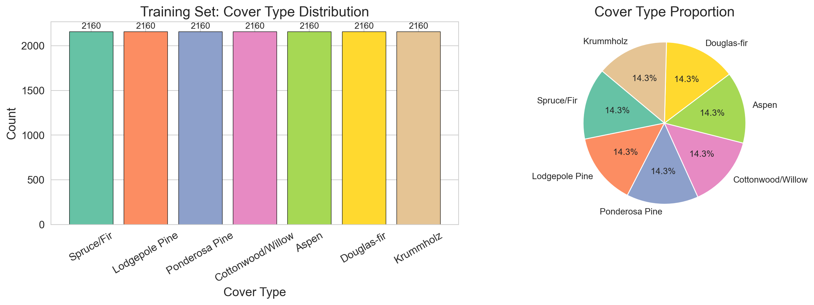

</div>

**Figure 1.** Distribution of forest cover types in the training set. All seven classes are perfectly balanced, with exactly 2,160 samples per class (14.3% each).

The training set exhibits a strictly balanced class distribution, with 2,160 samples in each of the seven forest cover types. This balanced structure is advantageous during model training, as it reduces the risk of class bias.

However, it also implies that local validation results may overestimate performance under the true data distribution, since the original Covertype dataset is typically not naturally balanced. In other words, this form of “idealized sampling” improves optimization convenience during development, but to some extent weakens the direct representativeness of the online test distribution.

This discrepancy explains why leaderboard feedback becomes an important complementary reference for evaluating real-world generalization performance.

### 2.3 Continuous Feature Analysis

The continuous variables primarily describe terrain characteristics, illumination conditions, and distance-based disturbance proxies. They constitute the most ecologically interpretable group of features in the dataset. Table 3 summarizes their physical meanings and key observational properties.

**Table 3. Summary of continuous features.**

| Feature | Description | Unit | Key Observation |
|:--------|:------------|:----:|:----------------|
| `Elevation` | Elevation above sea level | meters | **Most discriminative feature**, informative across all cover types |
| `Aspect` | Slope aspect (azimuth) | degrees (0–360) | Circular variable requiring transformation |
| `Slope` | Slope angle | degrees | Influences drainage and solar exposure |
| `Horizontal_Distance_To_Hydrology` | Horizontal distance to nearest surface water | meters | Proxy for water availability |
| `Vertical_Distance_To_Hydrology` | Vertical distance to nearest surface water | meters | Can be negative (below water level) |
| `Horizontal_Distance_To_Roadways` | Horizontal distance to nearest roadway | meters | Proxy for anthropogenic disturbance |
| `Hillshade_9am` | Hillshade index at 9 a.m. (summer solstice) | 0–255 | Related to slope orientation |
| `Hillshade_Noon` | Hillshade index at noon (summer solstice) | 0–255 | Strongly correlated with `Hillshade_3pm` |
| `Hillshade_3pm` | Hillshade index at 3 p.m. (summer solstice) | 0–255 | Strong negative correlation with `Hillshade_9am` |
| `Horizontal_Distance_To_Fire_Points` | Horizontal distance to nearest wildfire ignition points | meters | Indicator of historical fire disturbance |

<div align="center">

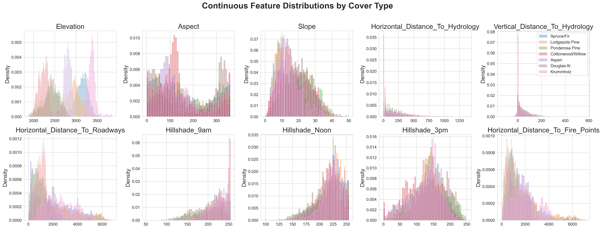


</div>

**Figure 2.** Kernel density estimates of all ten continuous features, colored by forest cover type. Among them, `Elevation` exhibits the strongest class separation capability.


From the distribution plots, it is evident that `Elevation` contributes most directly to class separation. The distribution of Type 7 is clearly shifted toward higher elevation ranges, whereas Types 3 and 4 are more concentrated in lower elevation zones.

In comparison, `Slope`, the `Hillshade` variables, and the distance-based features exhibit discriminative power primarily at a more localized level. Individually, they are often insufficient to fully separate classes, but they provide critical complementary information within overlapping regions.

<div align="center">

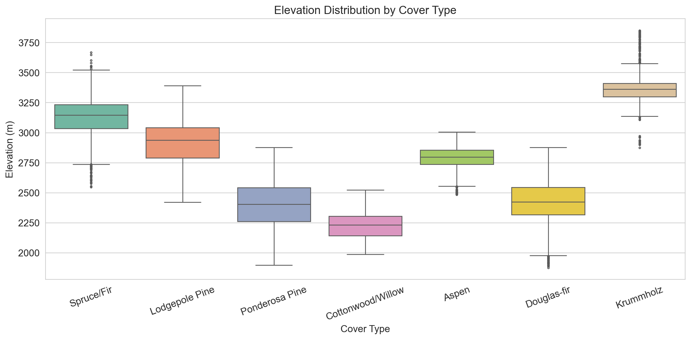


</div>

**Figure 3.** Boxplots of `Elevation` by forest cover type. The median elevation clearly separates the classes into three strata: Types 3/4/6 (low elevation), Types 2/5 (mid elevation), and Types 1/7 (high elevation).


The boxplots further indicate that although `Elevation` is highly informative, it is not a sufficient condition for class separation. Types 1 and 2 exhibit substantial overlap within the mid-to-high elevation range, and Type 5 lies adjacent to both. As a result, model error rates are generally higher for these categories.

In other words, `Elevation` primarily governs a form of coarse-grained stratification, whereas high-quality classification requires the incorporation of additional features that capture finer-scale micro-environmental differences.

### 2.4 Wilderness Area Analysis

<div align="center">

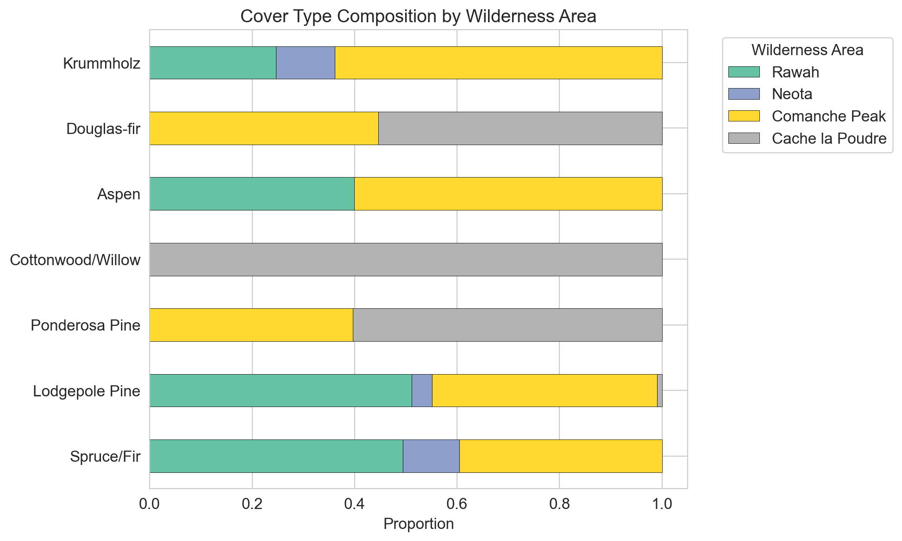

</div>

**Figure 4.** Proportional composition of wilderness areas within each forest cover type. The Neota area is dominated by high-elevation types (Types 1 and 7), whereas Cache la Poudre consists almost exclusively of low-elevation types (Types 3, 4, and 6).


<div align="center">
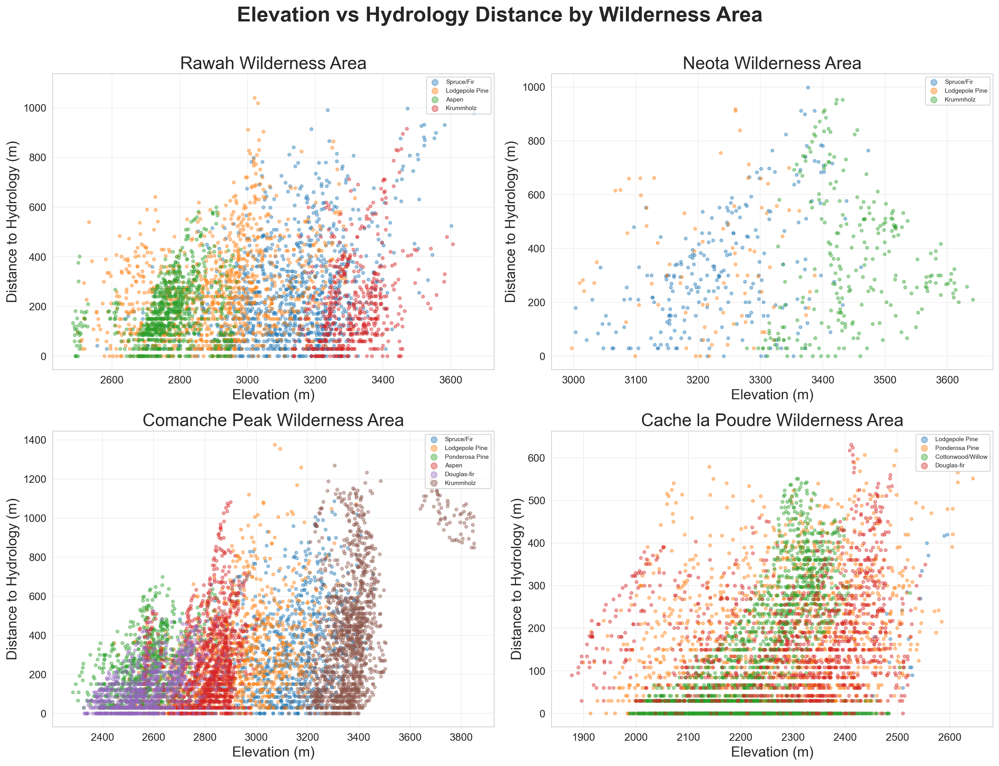
</div>

**Figure 5.** Scatter plots of `Elevation` versus `Horizontal_Distance_To_Hydrology` across the four wilderness areas, colored by forest cover type. Each wilderness area exhibits distinct spatial patterns and species composition.


The `Wilderness_Area` variable should not be interpreted as a mere geographic label, but rather as a compressed encoding of ecological niche differences. The four wilderness areas exhibit long-standing and systematic differences in elevation distribution, terrain variability, and hydrological conditions. As a result, this variable inherently carries prior information relevant to classification.

The scatter plots further indicate that samples of the same forest cover type do not completely overlap across different wilderness areas. This observation suggests that subsequent modeling should allow the classifier to capture both global type-level patterns and region-specific local structures, rather than treating all samples as if they were drawn from a single homogeneous distribution.

### 2.5 Soil Type Analysis

<div align="center">

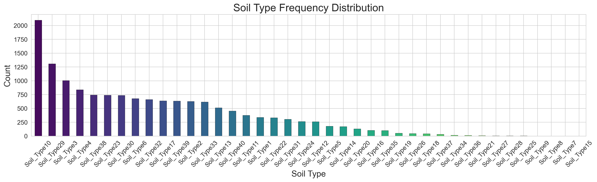


</div>

**Figure 6.** Frequency distribution of the 40 `Soil_Type` indicators. The distribution is highly skewed: Soil Types 10, 29, and 23 dominate the dataset, whereas Types 7, 8, and 15 appear only rarely.


The 40 `Soil_Type` variables exhibit a pronounced long-tailed distribution, which introduces a dual impact on model training. First, high-frequency soil types provide stable statistical signals and are therefore more likely to be prioritized during tree-based splitting. Second, although low-frequency soil types are represented by relatively few samples, they may correspond to specific ecological conditions. Ignoring them could lead to systematic misclassification within particular spatial regions.

According to the USFS Ecological Landtype Unit (ELU) coding scheme, soil types implicitly encode hierarchical information related to climatic and geologic zones. Consequently, subsequent feature engineering may consider constructing grouped semantic features while retaining the original one-hot representation, in order to enhance generalization capacity.

### 2.6 Feature Correlation Structure

<div align="center">
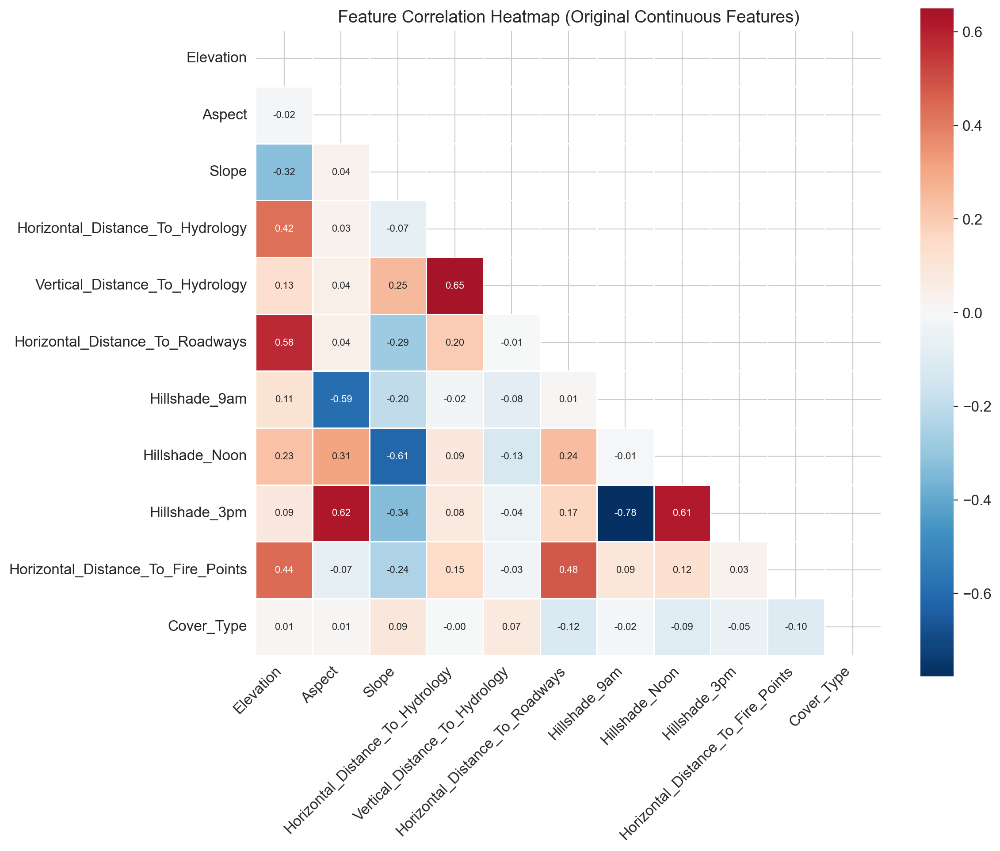


</div>

**Figure 7.** Pearson correlation matrix of the continuous variables. Notable correlations include `Hillshade_9am` ↔ `Hillshade_3pm` ($r \approx -0.78$) and `Horizontal_Distance_To_Hydrology` ↔ `Vertical_Distance_To_Hydrology` ($r \approx 0.60$).


<div align="center">

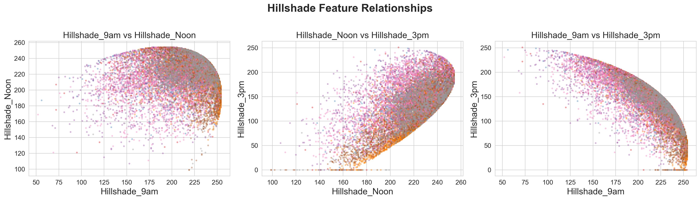


</div>

**Figure 8.** Pairwise scatter plots of the three `Hillshade` variables. The strong negative correlation between `Hillshade_9am` and `Hillshade_3pm` reflects the complementary solar exposure patterns of east-facing and west-facing slopes.


The correlation analysis suggests that relying solely on the original variables may cause the model to repeatedly learn similar information from strongly correlated features. For instance, the three `Hillshade` variables essentially represent snapshots of the same solar illumination process at different times of the day. While including them directly is informative, a more effective approach is to extract derived statistics or difference-based features that explicitly encode temporal variation patterns in a more compact and stable form.

### 2.7 Dimensionality Analysis

<div align="center">

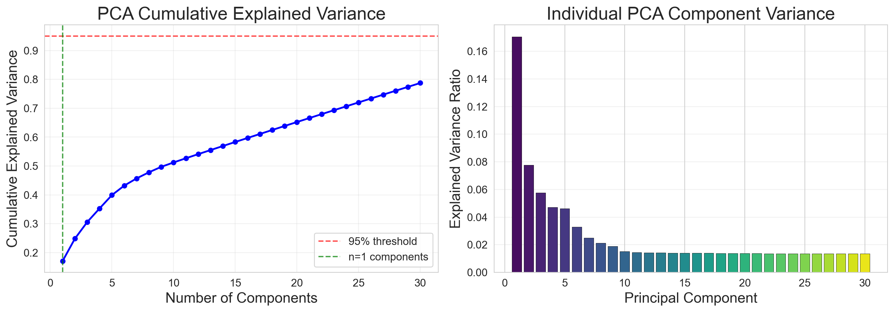
</div>

**Figure 9.** Principal Component Analysis (PCA) of the engineered feature space.  

Left: cumulative explained variance, showing that approximately 15 principal components capture 95% of the total variance.  
Right: individual contribution of each principal component.


<div align="center">

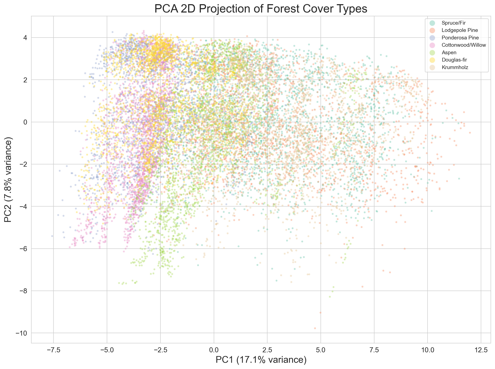

</div>

**Figure 10.** Two-dimensional PCA projection of all training samples. Although some clustering structure can be observed, substantial overlap remains between classes.


<div align="center">

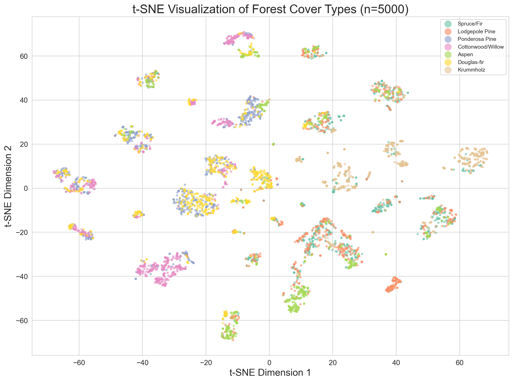

</div>

**Figure 11.** Two-dimensional t-SNE embedding of 5,000 randomly sampled training points (perplexity = 50). The nonlinear structure reveals clearer class separation compared to PCA.


The comparison between PCA and t-SNE indicates that substantial overlap persists under low-dimensional linear projections, whereas separation among certain classes improves noticeably in the nonlinear embedding space. 

This observation supports the subsequent methodological choice: prioritizing models capable of expressing higher-order nonlinear decision boundaries, and leveraging ensemble mechanisms to combine different models’ preferences over local data structures.

## 3. Methodology
This methodology is jointly composed of three parts: feature engineering, heterogeneous base learners, and Stacking with Passthrough. The overall idea is to first improve the quality of input representations, then enhance decision robustness through model diversity, and finally perform adaptive, sample-level integration via meta-learning.

### 3.1 Feature Engineering
Based on geographic and ecological knowledge, we introduced 20 new features, expanding the total dimensionality from 54 to 74. This procedure is not a mechanical concatenation, but is organized around four goals: eliminating encoding defects, reconstructing spatial relationships, extracting temporal patterns, and characterizing terrain interactions.

<div align="center">

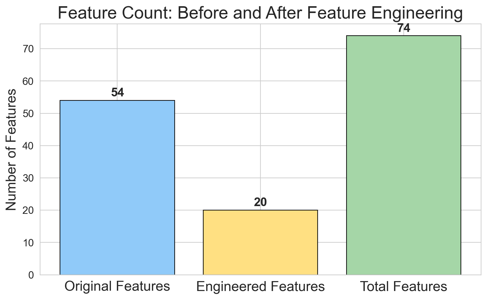

</div>

**Figure 12.** Dimensional change before and after feature engineering: 54 raw features + 20 engineered features = 74 total features.


Firstly, the circular nature of `Aspect` means it cannot be treated as an ordinary continuous variable. Although 0° and 360° indicate the same geographic direction, they are numerically far apart, which can mislead distance metrics and tree splitting. We apply the standard trigonometric transformation to map it into orthogonal coordinates:

$$
\text{Aspect\_sin} = \sin\!\left(\frac{\pi \cdot \text{Aspect}}{180}\right), \quad
\text{Aspect\_cos} = \cos\!\left(\frac{\pi \cdot \text{Aspect}}{180}\right)
$$
This transformation allows directional information to enter the model in a continuous and compositional form, so that exposure differences along “east–west” and “north–south” can be expressed separately.

<div align="center">

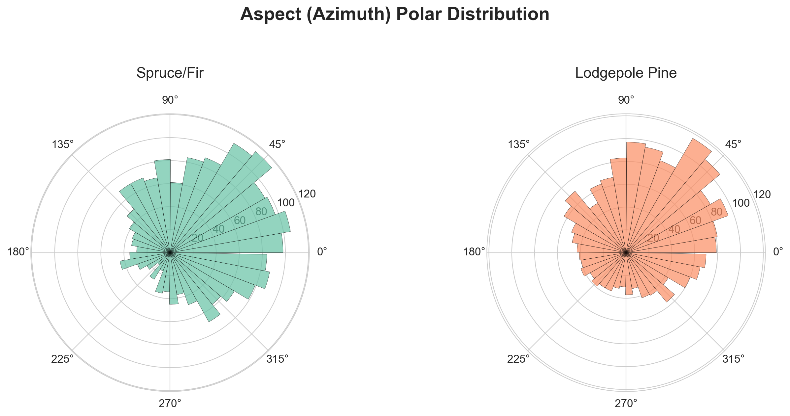


</div>

**Figure 13.** Polar histograms of Aspect for Spruce/Fir (Type 1) and Lodgepole Pine (Type 2). Its circular property illustrates the necessity of the sin/cos transformation.


Secondly, we reconstruct the horizontal and vertical distances to hydrology into an Euclidean distance to better reflect real accessibility on terrain:

<div align="center">

$d_{\text{euclidean}} = \sqrt{d_{\text{horizontal}}^2 + d_{\text{vertical}}^2}$

</div>

This feature merges information that was originally split across two axes into a single magnitude, more directly representing the overall difficulty of water accessibility.

Thirdly, for the three time-point `Hillshade` variables, we extract the maximum, minimum, mean, and range. The key idea is to elevate time-specific observations into a characterization of “illumination shape.” The range is especially important because it reflects diurnal illumination amplitude induced by terrain orientation, which is highly informative for distinguishing shaded vs. sun-exposed slopes.

Fourthly, we construct interaction terms around elevation, including additive/subtractive combinations between elevation and vertical hydrology distance, as well as horizontal roadway distance. The core motivation is to combine “absolute elevation” with “relative position,” thereby capturing the joint effects of terrain position and human disturbance. For example, `Elevation - H_Dist_Roadways` can be interpreted to some extent as a remote-highland index, providing extra discriminative power for certain high-elevation conifer classes.

Finally, we build combination relationships among the three horizontal distance variables, including pairwise sums/differences, absolute differences, and the mean facility distance, while keeping the absolute form of vertical hydrology distance. This group of features extends “distance to a single facility” into “geometric relationships among facilities”, better characterizing the integrated spatial structure of anthropogenic disturbance and natural factors.

**Table 4.** Summary of engineered features.
| Category | Count | Design Rationale |
|:---|:---:|:---|
| Circular variable transformation | 2 | Eliminate the discontinuity of Aspect |
| Distance reconstruction | 1 | True Euclidean distance to hydrology |
| Hillshade temporal statistics | 4 | max/min/mean/range of Hillshade |
| Elevation interactions | 4 | Combinations of elevation × distance |
| Distance interactions | 9 | Pairwise distance patterns among facilities |
| **TOTAL** | **20** | **54 → 74 FEATURES** |

<div align="center">

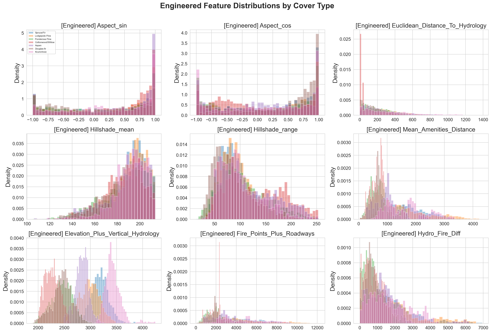

</div>

**Figure 14.** Density distributions of selected engineered features by cover type. Features such as `Euclidean_Distance_To_Hydrology` and `Hillshade_range` show clearer class separation than some original variables.


### 3.2 Modeling Rationale and Architecture Formation

The model architecture was not fixed beforehand and then applied directly; instead, it was gradually derived from data observations and baseline experiments. We first built a baseline using Random Forest on the original 54-dimensional features, achieving an accuracy of about 0.790. This indicates that tree models can reliably handle mixed inputs of soil one-hot variables and continuous terrain variables, but it also exposes a clear bottleneck: in overlap regions such as class 1/2 and 3/6, a single tree-based model struggles to produce stable decision boundaries. We then expanded the features to 74 dimensions and continued testing, and the score improved to about 0.815. This step validates a key judgment: for the current task, the upper bound is constrained first by representation capacity, rather than purely by model capacity.

On this basis, we further compared several candidate models. XGBoost performs better on complex feature interactions, pushing the score to around 0.825. ExtraTrees achieves a higher mean in cross-validation, suggesting that more aggressive randomized splitting is beneficial for this task. However, these two models are essentially both tree-family methods and thus have high similarity in their prediction patterns. If we only combine within tree models, the incremental information gained from ensembling will be limited. To break this homogeneity, we introduced a Radius Neighbors Classifier (RNC). Although its single-model performance is lower than tree models, its decision logic is fundamentally different and can provide judgments that are markedly different from tree models in local density structures—exactly the complementary signal that Stacking needs.

Therefore, the final architecture forms a clear division of labor. Random Forest provides robust high-dimensional sparse partitioning; XGBoost captures higher-order nonlinear interactions; ExtraTrees adds another tree-model bias via stronger randomization; RNC offers a local-neighborhood view and heterogeneous boundaries. This combination is not intended to pursue “the more models the better,” but to ensure each base learner addresses a different type of uncertainty, so that the meta-learning stage can exploit meaningful disagreements.

For the second layer, we do not use simple weighted voting. Instead, we adopt XGBoost as the meta-learner and enable Passthrough. The reason is that in this task, “which base model is more trustworthy” depends strongly on sample context, such as elevation bands, wilderness areas, and illumination patterns. When the meta-learner can see both the base learners’ probability outputs and the original features, it can learn a conditional decision mechanism that dynamically adjusts model trust across ecological regions—more consistent with the problem structure than globally fixed weights.

<div align="center">

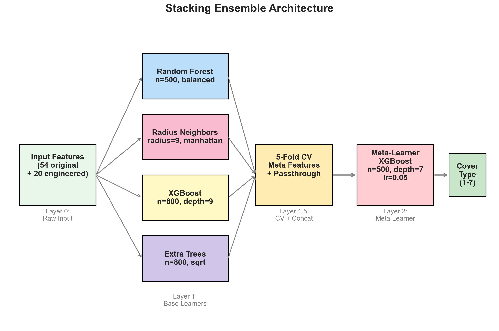

</div>

**Figure 15.** The proposed Stacking ensemble architecture. Outputs from four heterogeneous base learners feed into the meta-learner, while original features are passed through via Passthrough.


Random Forest serves as the robust backbone, using bootstrap sampling and random sub-feature splits to control variance, and adapting well to high-dimensional sparse soil variables. After standardization, the Radius Neighbors Classifier uses Manhattan distance to explicitly model local density structure; although its single-model score is lower, it provides decision boundaries that differ substantially from tree models. XGBoost learns higher-order nonlinear interactions and is particularly effective at discovering complex threshold relationships in continuous variables and engineered combinations. ExtraTrees supplements another tree-model bias via more aggressive randomized splits, improving overall robustness.

Base learner hyperparameters are as follows:


```python
RandomForestClassifier(
    n_estimators=500, max_depth=None, max_features=0.3,
    class_weight="balanced", random_state=8, n_jobs=-1
)

Pipeline([
    ("scaler", StandardScaler()),
    ("rnc", RadiusNeighborsClassifier(
        radius=9, weights="distance", metric="manhattan",
        outlier_label="most_frequent", n_jobs=-1
    ))
])

XGBClassifier(
    n_estimators=800, max_depth=9, learning_rate=0.1,
    subsample=1, colsample_bytree=1,
    eval_metric="mlogloss", random_state=42, n_jobs=-1
)

ExtraTreesClassifier(
    n_estimators=800, max_depth=None, max_features="sqrt",
    random_state=42, n_jobs=-1
)
```

### 3.3 Stacking Mechanism and Passthrough Strategy
<div align="center">

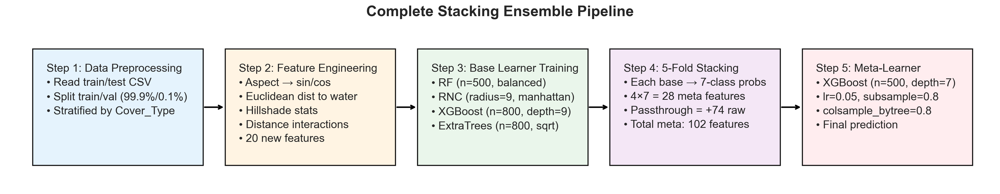

</div>

**Figure 16.** End-to-end pipeline: data preprocessing → feature engineering → 5-fold base training → meta-feature generation → meta-learner prediction.


In the first layer of Stacking, we use 5-fold cross-validation to generate out-of-fold predictions, ensuring that every training sample receives probability outputs from models that have not seen that sample. Each of the four base learners outputs probabilities over seven classes, yielding 28 meta-features in total. These meta-features are then concatenated with the 74 raw/engineered features and fed into the meta-learner. The concatenated 102-dimensional input allows the second layer not only to interpret “which model is more reliable,” but also to revisit “what ecological context the sample belongs to”—which is precisely the value of the Passthrough strategy.

Meta-learner hyperparameters are as follows:

```python
XGBClassifier(
    n_estimators=500, max_depth=7, learning_rate=0.05,
    subsample=0.8, colsample_bytree=0.8,
    eval_metric="mlogloss", random_state=42, n_jobs=-1
)
```

**Table 5.** Hyperparameter comparison between the base XGBoost and the meta-learner XGBoost.

| Parameter | Base XGBoost | Meta-learner | Design Rationale |
|:---|:---:|:---:|:---|
| `n_estimators` | 800 | 500 | Meta-features are more condensed; fewer iterations are required |
| `max_depth` | 9 | 7 | Control meta-layer complexity and suppress overfitting |
| `learning_rate` | 0.1 | 0.05 | More conservative updates at the meta layer |
| `subsample` | 1.0 | 0.8 | Improve generalization robustness |
| `colsample_bytree` | 1.0 | 0.8 | Reduce reliance on any single meta-feature |

### 3.4 Training Strategy

Under relatively limited training data, this work places its primary validation pressure on Stacking’s internal cross-validation procedure. Locally, we retain only a very small fraction of samples for quick sanity checks, while the core judgments are based on out-of-fold performance and online submission feedback. The motivation is to maximize sample utilization for each base learner during training and reduce under-learning caused by excessive holdout. Although this practice sacrifices some stability in local estimation, it can more effectively improve final submission performance in a competition setting.

## 4. Experiments and Results

### 4.1 Experimental Setup

- The experimental environment uses Python 3.9, with scikit-learn and XGBoost as the core dependencies. During training, parallel computation is enabled via `n_jobs=-1` to accelerate multi-model training. 
- Performance evaluation consists of two parts: locally, 5-fold stratified cross-validation is used to observe model stability; online, Kaggle Public Leaderboard accuracy is used to evaluate practical generalization performance. 
- This dual-track evaluation framework helps distinguish between “learnability under a balanced training distribution” and “final usability under the true test distribution.”


### 4.2 Single-Model Performance and Ensemble Results

<div align="center">
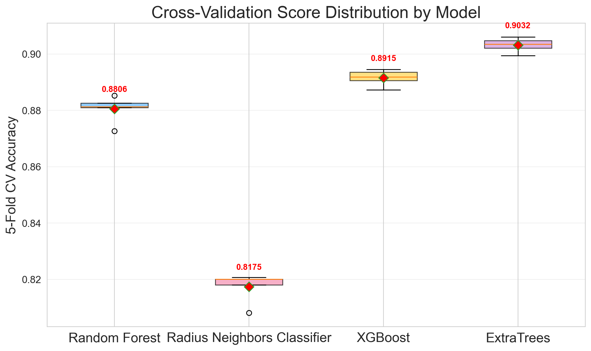
</div>


**Figure 17.** Distribution of 5-fold cross-validation accuracy for each base learner. The red diamond marker indicates the mean. Extra Trees achieves the highest single-model CV score (0.9027), followed closely by XGBoost (0.8914).

**Table 6. Base-learner performance summary (5-fold CV)**

| Model | Mean CV Accuracy | CV Std. Dev. | Learning Paradigm |
|:---|:---:|:---:|:---|
| Random Forest | 0.8825 | ±0.0037 | Bagging |
| Radius Neighbors Classifier| 0.8175 | ±0.0047 | Instance-based |
| XGBoost | 0.8914 | ±0.0032 | Boosting |
| Extra Trees | 0.9027 | ±0.0031 | Randomized Bagging |
| **Stacking Ensemble** | **0.8397** | — | **Meta-learning** |

- It should be emphasized that the base-model scores in the table come from cross-validation on the balanced training set, whereas the Stacking value corresponds to **Kaggle Public Leaderboard accuracy**. Since the evaluation distributions and evaluation procedures differ, the two cannot be compared one-to-one directly. 
- Nevertheless, the single-model results still clearly reflect one fact: tree-based models are overall stronger than instance-based models, and the core value of RNC is not in point accuracy, but in providing heterogeneous information for the ensemble.


### 4.3 Learning Curves and Generalization Assessment

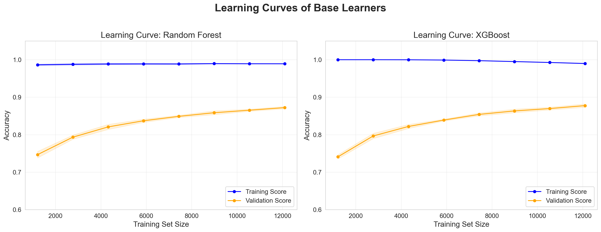

**Figure 18.** Learning curves for Random Forest (left) and XGBoost (right). As training data increases, the validation score continues to improve.

- The learning curves show that neither model has fully converged at the current data scale; in the high-sample region, the validation curve remains upward-trending, indicating that additional data could theoretically still bring gains. 
- Meanwhile, both models exhibit a non-negligible gap between training and validation scores, indicating a mild degree of overfitting.


### 4.4 Per-Class Performance and Error Structure
<div align="center">
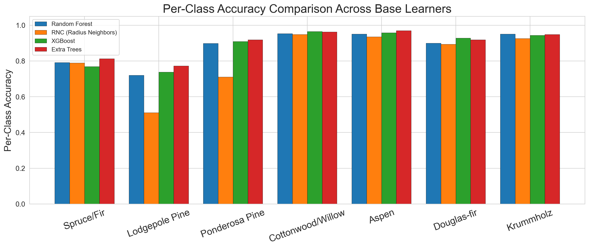
</div>

**Figure 19.** Per-class accuracy of each base learner.


<div align="center">

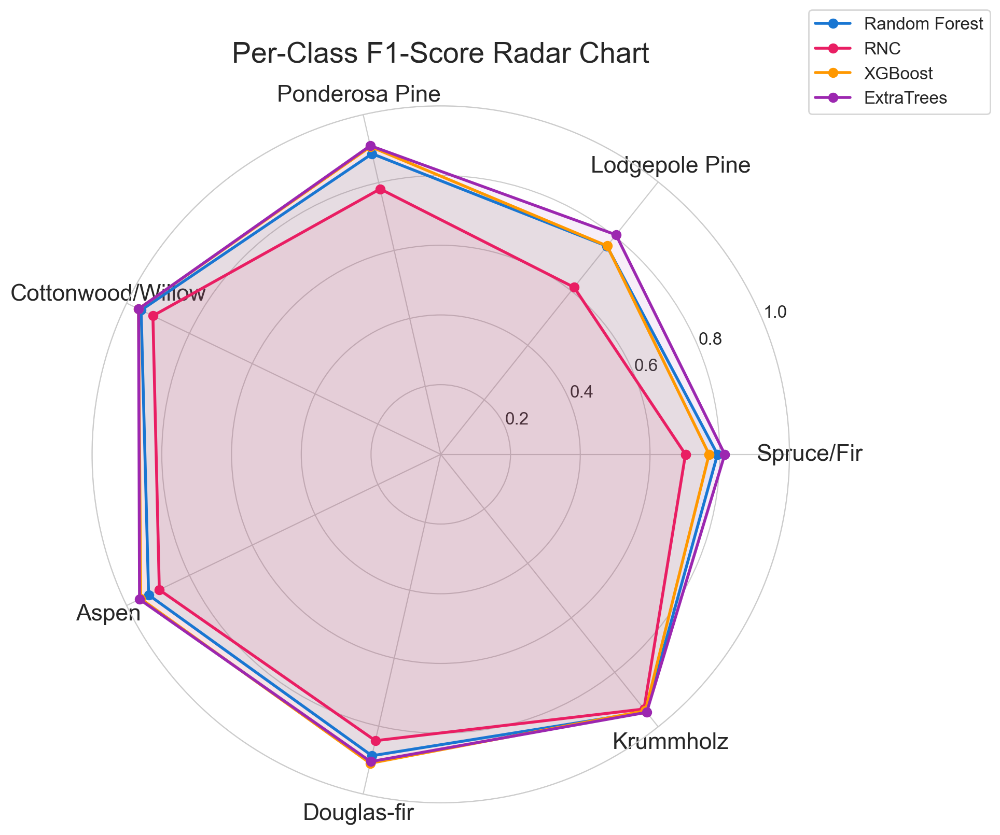

</div>

**Figure 20.** Per-class F1 radar plot for each base learner.

- From the per-class metrics, the four base models achieve lower accuracy on Types 1, 2, 3, and 6, whereas performance on Types 4, 5, and 7 are relatively higher and more consistent.
- This is highly consistent with ecological separability: the elevation and wildness area characteristics of Type 4, 5, 7 make their boundaries clearer, whereas Types 1, 2, 3, and 6 lie in overlapping features.

<div align="center">
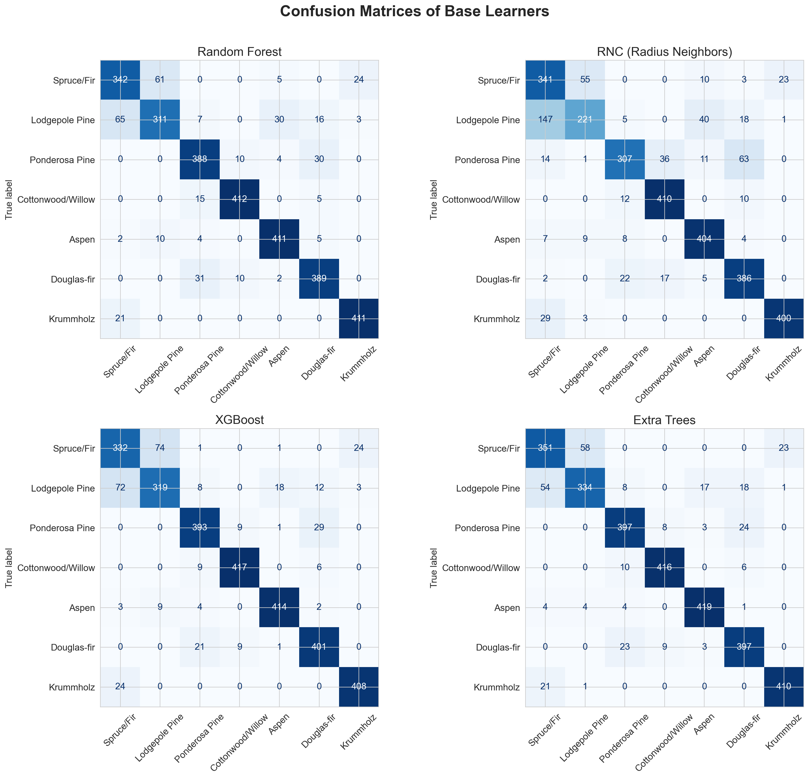
</div>

**Figure 21.** Confusion matrices of the four base learners on the validation set. The main confusion pairs are Type 1 ↔ Type 2 and Type 3 ↔ Type 6.

- The confusion matrices reveal two stable error patterns. 
- The first is the bidirectional misclassification between Types 1 and 2, reflecting a blurred boundary among mid-to-high-elevation conifer forests. 
- The second is mutual confusion between Types 3 and 6, indicating that differences among mid-to-low-elevation classes are more reflected in micro-topography and local environments rather than a single macroscopic variable.

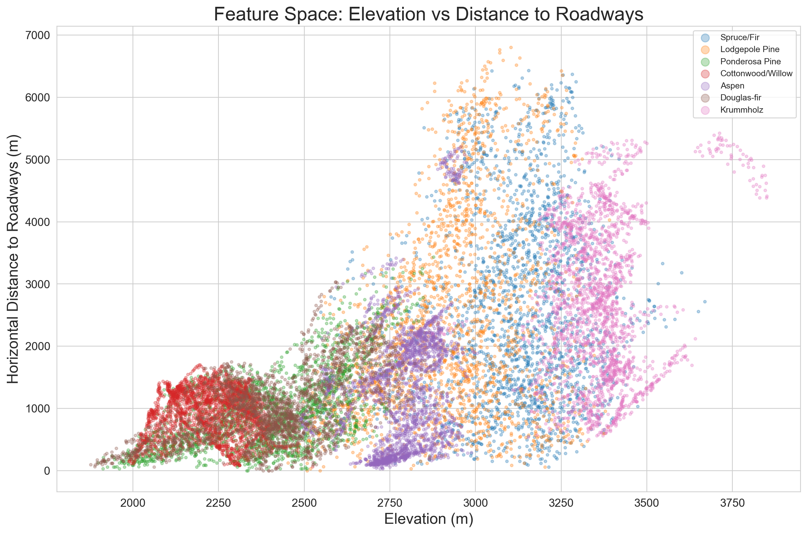

**Figure 22.** A 2D scatter plot of elevation and distance to roadways. Overlap regions among classes explain the task’s upper bound on discriminability.


### 4.5 Model Agreement and Feature Importance

<div align="center">

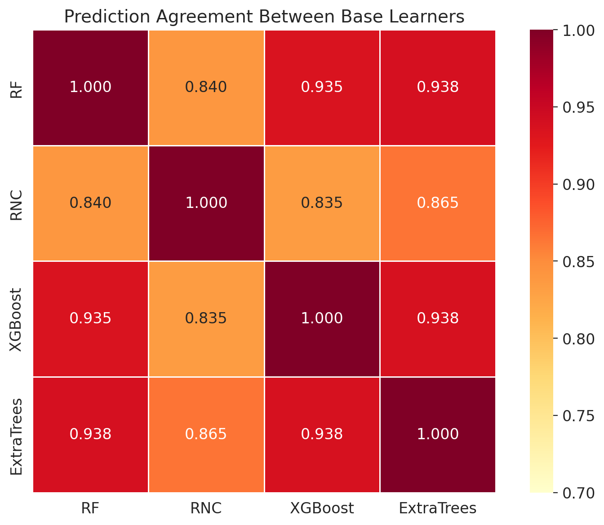

</div>

**Figure 23.** Pairwise prediction agreement rates among base learners. RF and ET have the highest agreement, while RNC has the lowest agreement with the others.

- The agreement results validate the rationale of heterogeneous ensemble design. 
- RF and ET are highly consistent due to similar learning mechanisms, which helps provide a stable baseline.
- RNC’s agreement rate with other models is significantly lower, meaning it offers different judgments on a substantial portion of samples and provides informative disagreement signals to the meta-learner
- XGBoost lies in a medium-agreement region relative to the two Bagging models, serving as a bridge between stability and flexibility.

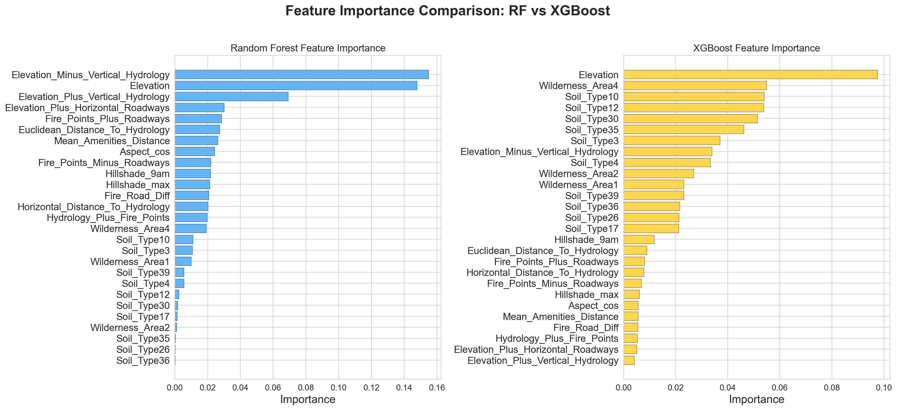

**Figure 24.** Feature-importance comparison between Random Forest and XGBoost. Both rank elevation among the top two features, but differ in how they order engineered features.
<div align="center">
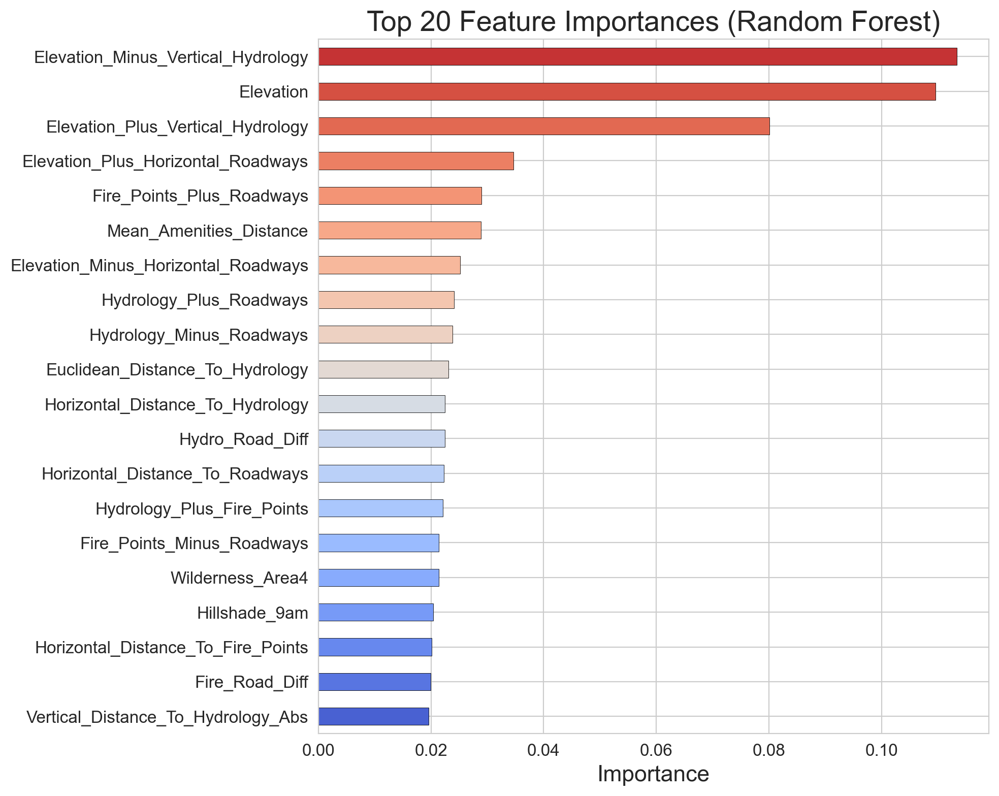
</div>

**Figure 25.** Top 20 most important features in Random Forest. Multiple engineered features rank highly.

- Feature-importance analysis yields three conclusions. 
- First, elevation is consistently an irreplaceable primary feature, reflecting the fundamental constraint of ecological gradients on tree-species distribution. 
- Second, engineered features rank among the top features in multiple models, indicating that these new variables are not redundant dimensional expansion, but genuinely improve separability.
- Third, different models exploit the same feature set in different orders, and such differences are precisely what allows Stacking to continue benefiting.


## 5. Discussion

### 5.1 Development Path and Incremental Gains
<div align="center">
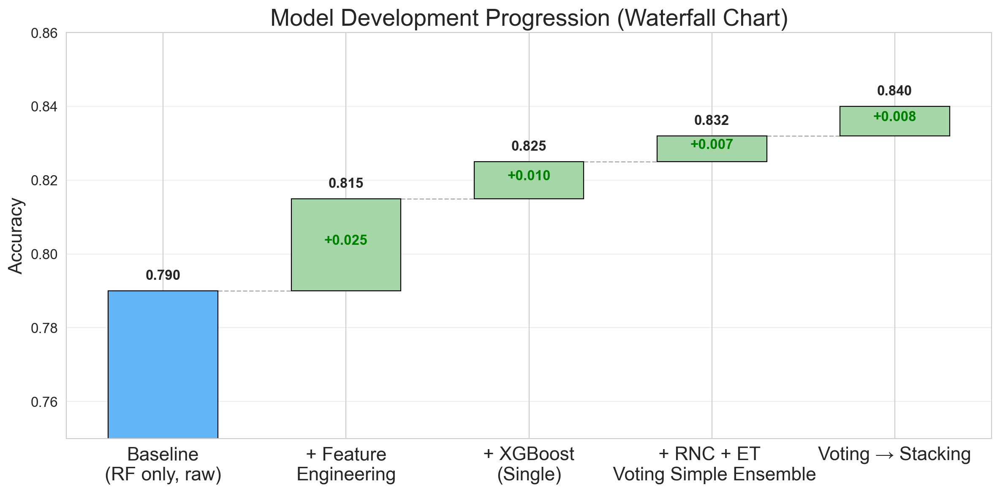
</div>

**Figure 26.** Incremental accuracy gains throughout development: from baseline Random Forest (0.790) to final Stacking (0.840).

**Table 7. Development iteration summary**

| Stage | Method | Accuracy | Δ Accuracy |
|:---|:---|:---:|:---:|
| Baseline | RF + 54 raw features | 0.790 | — |
| + Feature engineering | RF + 74 features | 0.815 | +0.025 |
| + Stronger model | XGBoost single model | 0.825 | +0.010 |
| + Simple ensemble | Voting (RF + XGBoost + ET + RNC) | 0.832 | +0.007 |
| Voting → Stacking | Full Stacking | **0.840** | **+0.008** |

- All reported accuracy values above are based on Kaggle Public Leaderboard results.
- From the development process, the largest single-step gain comes from feature engineering rather than replacing the model. This result suggests that in the current task, getting the input representation right is more effective than blindly increasing model complexity. 
- Subsequent ensemble gains are smaller, but stable and persistent, reflecting that the engineering path of “build a strong feature foundation first, then refine via model fusion” is reusable.


### 5.2 Mechanistic Explanation of Stacking Effectiveness

The gains from Stacking can be understood from an information-theoretic perspective. When first-layer models output different probability distributions on the same sample, they are essentially exposing different sources of uncertainty about that sample. By learning the joint relationship between these probability patterns and the raw features, the meta-learner can identify which disagreements are valuable and which are merely noise. The passthrough mechanism makes this process more reliable because it avoids information loss from “only seeing model opinions but not sample context.” When all base models deviate simultaneously on some rare combination, the meta-learner can still correct using the raw features.


### 5.3 Limitations and Room for Improvement

- This study still has several limitations. 
- First, the training set is balanced while the test distribution is unknown, creating an inherent mismatch between development-stage metrics and online metrics. 
- Second, hyperparameters were mainly determined via manual trials rather than systematic global search, leaving potential room for improvement. 
- Third, the input variables come only from cartographic and ecological encodings and lack finer-grained remote-sensing spectra or time-series information, which limits the upper bound of separability for similar types. 
- Finally, in order to maximize Kaggle performance, the final model was trained on nearly the full dataset, leaving only a minimal holdout set. While this strategy improves training data utilization and leaderboard accuracy, it reduces the stability of local evaluation and makes model tuning more dependent on online feedback.


## 6. Conclusion and Future Work

This report proposes an end-to-end solution for forest cover-type classification and achieves an accuracy of **0.83966** on the Kaggle Public Leaderboard. Overall results indicate a clear synergistic effect between domain-knowledge-driven feature engineering and heterogeneous Stacking ensembles. The former increases the semantic density of the inputs, while the latter improves decision-layer adaptability to complex samples; together, they drive the final performance gains.

**Table 8. Key outcome overview**

| Dimension | Content |
|:---|:---|
| Final accuracy | 0.83966 (Kaggle Public Leaderboard) |
| Core architecture | 4-base-learner Stacking + XGBoost meta-learner |
| Feature engineering | +20 geo-semantic features (54 → 74) |
| Highlights | Heterogeneous complementarity + passthrough information retention |

Future improvements can be advanced along three main directions:

1. Expand model diversity by introducing LightGBM, CatBoost, and neural-network base learners.
2. Improve optimization systematization using frameworks such as Optuna for joint hyperparameter search.
3. Deepen feature semantics through hierarchical soil encoding, pseudo-labeling, and integration of external ecological or remote-sensing data.